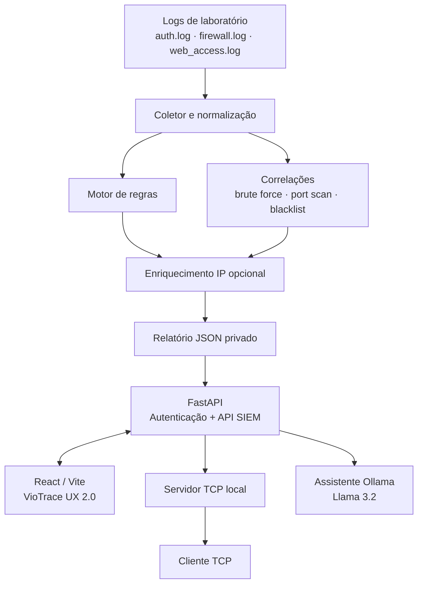

# VioTrace

**Plataforma educacional de monitoramento, detecção e investigação de eventos de segurança**

O **VioTrace** é uma interface de operações de segurança (*SOC*) desenvolvida para explorar o funcionamento de um **SIEM** (*Security Information and Event Management*). Ele amplia o núcleo Python **SecuraPy** com um painel web, autenticação por perfil, investigação de IPs, operação do pipeline de detecção pelo navegador, transmissão TCP de alertas e um assistente de IA local.

> **Escopo:** MVP acadêmico, para ambientes autorizados de laboratório. Os logs de exemplo são analisados sob demanda; o servidor TCP retransmite alertas processados. **Não** há coleta automática contínua ou monitoramento de uma infraestrutura real em tempo real nesta versão.

## Conteúdo

- [Funcionalidades](#funcionalidades)
- [Tecnologias](#tecnologias)
- [Arquitetura](#arquitetura)
- [Estrutura do repositório](#estrutura-do-repositório)
- [Instalação e execução no Windows](#instalação-e-execução-no-windows)
- [Como usar](#como-usar)
- [API e permissões](#api-e-permissões)
- [Testes e evidências](#testes-e-evidências)
- [Segurança e limitações](#segurança-e-limitações)
- [Equipe](#equipe)

## Funcionalidades

| Área | Recursos disponíveis |
| --- | --- |
| **Visão geral** | Indicadores de eventos, alertas por regras, gravidade e IPs com padrões correlacionados. |
| **Alertas** | Consulta, busca, filtros e detalhamento de alertas gerados pelo motor de regras. |
| **Inteligência de IPs** | Histórico de eventos/alertas por endereço, enriquecimento geográfico quando disponível e correlações. |
| **Operações SIEM** | Processar os três arquivos de logs, consultar eventos, verificar detecções e exportar relatórios JSON. |
| **Regras de detecção** | Consultar regras e, com perfil administrador, ativá-las ou desativá-las. |
| **Servidor TCP** | Iniciar o servidor local, conectar clientes e retransmitir alertas existentes. |
| **Assistente IA** | Perguntas em português sobre evidências do relatório por meio do **Ollama / Llama 3.2 (3B)**, executado localmente. |
| **Acessos e convites** | Login, cadastro mediante convite de uso único, perfis administrador/analista, suspensão e reativação de usuários. |

Os tipos de detecção do núcleo incluem login privilegiado, portas críticas, XSS, *path traversal*, reconhecimento web, *brute force*, *port scan* e cruzamento com uma lista local de IPs.

## Tecnologias

| Camada | Tecnologias |
| --- | --- |
| Interface | React, Vite, JavaScript (JSX) e CSS responsivo |
| API | Python, FastAPI, Uvicorn e HTTPX |
| Núcleo SIEM | Python: `coletor.py`, `regras.py`, `detector.py`, `enriquecimento.py`, `relatorios.py` e módulos TCP |
| Inteligência artificial | Ollama e modelo local `llama3.2:3b` |
| Autenticação | Senhas com hash PBKDF2-HMAC-SHA256 e *salt*; tokens de sessão no backend |
| Persistência desta versão | Arquivos de configuração e relatórios JSON locais |
| Testes originais | Pytest |

**Nota:** o código desta versão utiliza JSON local; não documentamos MongoDB, MySQL ou Docker como integrações concluídas porque elas não foram demonstradas no fluxo implementado.

## Arquitetura



A interface consome a API FastAPI. O backend reutiliza o código do SecuraPy em vez de duplicar as regras e detecções no navegador. O arquivo de relatório protegido fica em `backend_ia/dados/relatorio.json` e **não deve ser publicado**.

### Separação de responsabilidades

- **Alertas por regras:** resultados de regras avaliadas sobre eventos individuais, como tentativas de login privilegiado e URLs suspeitas.
- **Detecções correlacionadas:** padrões descobertos pela combinação de eventos, como força bruta, varredura de portas e presença na blacklist configurada no laboratório.
- **Assistente IA:** interpreta o contexto fornecido pela API e recomenda ações defensivas; suas respostas podem conter erros e **não substituem as evidências** do SIEM.

## Estrutura do repositório

```text
GS_1Semestre/
├── README.md                  # Este documento
├── .gitignore                 # Proteção contra commits acidentais
├── frontend/
│   ├── public/                # Assets públicos: favicon/logo; NUNCA dados privados
│   ├── src/
│   │   ├── App.jsx            # Navegação, login, alertas, inteligência e chat
│   │   ├── PainelOperacoes.jsx
│   │   ├── PainelAcessos.jsx
│   │   ├── ResumoExecutivo.jsx
│   │   ├── Icon.jsx
│   │   ├── index.css
│   │   ├── operacoes.css
│   │   └── ux2.css
│   └── package.json
├── backend_ia/
│   ├── app.py                 # API principal e integração com Ollama
│   ├── seguranca.py           # Login, sessões e convites
│   ├── siem_api.py            # Operações SIEM
│   ├── admin_api.py           # Gestão administrativa
│   ├── requirements.txt
│   └── dados/                 # Relatórios privados (não versionar)
├── securaPy/
│   ├── main.py                # Menu CLI do núcleo original
│   ├── coletor.py
│   ├── regras.py
│   ├── detector.py
│   ├── enriquecimento.py
│   ├── relatorios.py
│   ├── servidor_alertas.py
│   ├── cliente_alertas.py
│   ├── config/regras.json
│   ├── logs/                  # Logs sintéticos de exemplo
│   ├── saida/                 # Relatórios gerados localmente
│   └── testes/
├── scripts/
│   ├── inicializar_ambiente.py
│   └── conferir_publicacao.py
└── docs/
    └── EVIDENCIAS.md
```

Diretórios de backups de instalações anteriores e ambientes virtuais podem existir localmente, mas não integram o produto executado.

## Instalação e execução no Windows

### Requisitos

- Windows com **Python** (a equipe executou os testes com Python 3.15), **Node.js/npm** e **Git**.
- **Ollama** instalado, caso queira usar o assistente IA; o modelo local é obtido com `ollama pull llama3.2:3b`.
- Portas locais disponíveis: `5173` (Vite), `8000` (API), `11434` (Ollama) e `9999` (TCP, quando iniciado).

> Os comandos abaixo usam **PowerShell**. A primeira execução depende de o repositório já conter o frontend e backend integrados desta versão do VioTrace.

**1. Obter o código** (ou abrir a cópia existente):

```powershell
git clone https://github.com/mandaszzzks/GS_1Semestre.git
cd GS_1Semestre
```

**2. Instalar as bibliotecas Python:**

```powershell
py -m pip install -r .\backend_ia\requirements.txt
py -m pip install pytest requests
```

**3. Instalar as dependências web:**

```powershell
cd .\frontend
npm.cmd install
cd ..
```

**4. Configuração inicial de uma NOVA cópia** (não é necessária se o administrador e o relatório já estão configurados):

```powershell
py .\scripts\inicializar_ambiente.py
```

O script cria uma conta administradora com senha digitada localmente, **somente se ela ainda não existir**, e inicializa o painel a partir de um relatório histórico ou, na ausência dele, processa os logs sintéticos de `securaPy/logs/`. Não substitui credenciais nem relatórios existentes.

**5. Preparar o modelo local (opcional para as telas sem IA):**

```powershell
ollama pull llama3.2:3b
```

Abra o aplicativo Ollama; confirme que está acessível em `127.0.0.1:11434`.

**6. Iniciar a API** (terminal 1):

```powershell
cd .\backend_ia
py -m uvicorn app:app --reload --host 127.0.0.1 --port 8000
```

**7. Iniciar a interface** (terminal 2, partindo da raiz do repositório):

```powershell
cd .\frontend
npm.cmd run dev
```

Abra **http://127.0.0.1:5173/** e faça login. Para verificar o backend: **http://127.0.0.1:8000/api/saude**.

### Inicialização do servidor TCP

Entre como administrador em **Operações SIEM → Servidor TCP → Iniciar servidor TCP**. Em outro terminal, execute:

```powershell
cd .\securaPy
py cliente_alertas.py
```

Depois, no navegador, clique em **Transmitir alertas aos clientes**. O transporte retransmite alertas do relatório existente e não inicia monitoramento automático de logs.

## Como usar

1. **Entrar:** o administrador usa suas credenciais locais; analistas criam conta com um convite gerado pelo administrador.
2. **Processar:** em **Operações SIEM**, clique em **Processar logs e detectar ataques** para analisar os arquivos em `securaPy/logs/`.
3. **Consultar:** explore eventos, alertas, severidades, detecções correlacionadas e informações de IP.
4. **Investigar:** selecione um endereço IP para visualizar seus eventos e alertas relacionados.
5. **Operar:** administradores podem atualizar regras, importar arquivos de log permitidos, enriquecer IPs e controlar o servidor TCP.
6. **Analisar com IA:** na página **Assistente IA**, selecione um IP ou pergunte sobre os dados do relatório atual. Revise as respostas antes de agir.
7. **Exportar:** utilize **Exportar relatório JSON** para obter uma cópia dos resultados para análise e apresentação.

## API e permissões

A documentação interativa da API pode ser consultada localmente em **http://127.0.0.1:8000/docs**.

| Método e rota | Finalidade | Perfil |
| --- | --- | --- |
| `POST /api/login` | Autenticar e obter sessão | Público, com credenciais |
| `POST /api/cadastro` | Criar conta por convite | Público, com convite válido |
| `GET /api/relatorio` | Ler relatório protegido | Autenticado |
| `POST /api/assistente` | Perguntar ao Ollama | Autenticado |
| `GET /api/siem/resumo` | Resumo da análise | Autenticado |
| `GET /api/siem/eventos` | Consultar e filtrar eventos | Autenticado |
| `GET /api/siem/ip/{ip}` | Investigar endereço IP | Autenticado |
| `GET /api/siem/regras` | Listar regras | Autenticado |
| `POST /api/siem/processar` | Executar coleta e detecção | Administrador |
| `PATCH /api/siem/regras/{id_regra}` | Ativar/desativar regra | Administrador |
| `POST /api/siem/tcp/iniciar` | Iniciar TCP | Administrador |
| `POST /api/siem/tcp/transmitir` | Retransmitir alertas | Administrador |
| `GET /api/admin/usuarios` | Listar contas | Administrador |
| `PATCH /api/admin/usuarios/{usuario}/status` | Suspender/reativar | Administrador |
| `GET /api/admin/convites` | Listar convites pendentes | Administrador |
| `DELETE /api/admin/convites/{hash}` | Revogar convite | Administrador |

As rotas privadas usam `Authorization: Bearer <token>`. Não inclua tokens reais em documentação, capturas ou commits.

## Testes e evidências

O núcleo original foi validado com o comando:

```powershell
cd .\securaPy
py -m pytest testes/ -v
```

**Resultado registrado em 08/11/2026:** `197 passed in 1.20s`, sem falhas. Esse número corresponde aos testes automatizados originais do SecuraPy; não equivale, sozinho, a uma auditoria de segurança ou cobertura completa das novas páginas e da IA.

**Cenário demonstrativo:** 58 eventos, 31 alertas gerados por regras e 3 IPs com detecções correlacionadas. A equipe também validou manualmente filtros de eventos, alteração de regras (31 → 27 → 31 alertas), investigação por IP, transmissão TCP (31 alertas), login/cadastro, suspensão/reativação e resposta HTTP **403** para acesso administrativo por analista.

As evidências e o roteiro para capturas constam de [`docs/EVIDENCIAS.md`](docs/EVIDENCIAS.md). Realize novamente os testes antes de entregar a versão publicada.

**Validação adicional recomendada:**

```powershell
cd .\frontend
npm.cmd run build
```

O build completo do frontend deve ser verificado na máquina de entrega; um build bem-sucedido é distinto dos testes Python.

## Segurança e limitações

- **Uso autorizado:** processar apenas logs de laboratório ou de sistemas sob sua administração.
- **Contas:** hashes e convites locais ficam em arquivos excluídos do Git; não são incluídos no projeto publicado.
- **Controle de acesso:** leitura permitida a analistas autenticados; operações administrativas são validadas também na API.
- **Dados de exemplo:** mantenha os arquivos públicos apenas com dados sintéticos; relatórios privados ficam no backend.
- **Assistente IA:** modelo local, sem chave de API externa. A IA pode interpretar incorretamente os dados; confira números, datas e correlações no SIEM.
- **Persistência:** armazenamento local em JSON, apropriado ao escopo acadêmico. Não há banco corporativo, armazenamento distribuído ou trilha completa de auditoria nesta versão.
- **Deploy:** configuração voltada ao host local (`127.0.0.1`). Não exponha os serviços à internet sem HTTPS, revisão de sessões, políticas de senha, proteção contra abuso, auditoria e revisão de segurança.
- **Tempo real:** a transmissão TCP é de alertas já calculados; não comprova captura contínua de eventos novos.

Antes de publicar, execute:

```powershell
py .\scripts\conferir_publicacao.py

git status --short
```

O `.gitignore` protege arquivos **não rastreados**. Se uma credencial já tiver sido adicionada ao Git em algum commit, ignorá-la agora não a apaga do histórico: será necessário removê-la do controle de versão e substituir a credencial comprometida.

## Equipe

Projeto acadêmico FIAP, desenvolvido em grupo:

| Integrante | RM |
| --- | --- |
| Amanda Souza Bezerra | 573911 |
| Caique dos Santos Rodrigues | 570577 |
| Davi Almeida Nascimento | 569447 |
| Maick Rosario Yamassaki | 569664 |

O **SecuraPy** é a base original do projeto. **VioTrace** é a identidade e interface ampliada desta evolução. A distribuição final de módulos deve ser confirmada pelo grupo antes da submissão.

---

**VioTrace · Observe. Investigue. Responda.**
